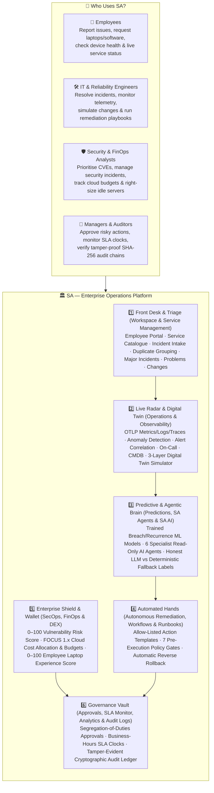
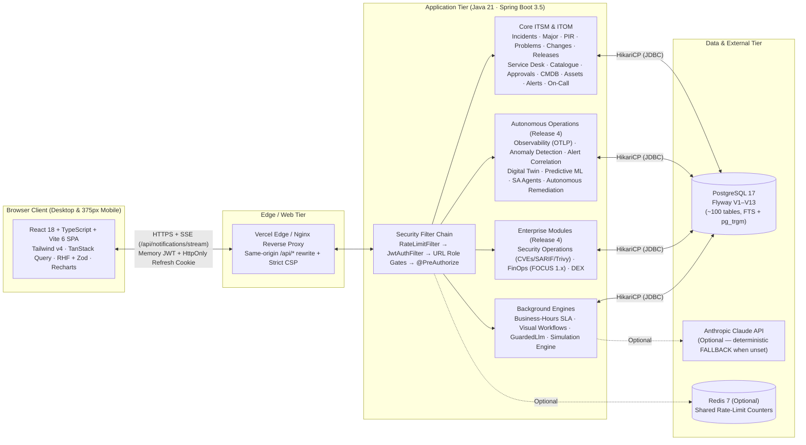
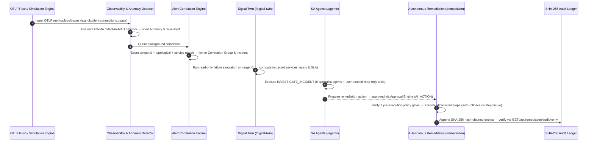

# SA — Enterprise Operations Platform

*Intelligent Service Management. Unified Operations.*

[](https://nexus360-three.vercel.app)
[-1d4ed8?style=for-the-badge)](https://nexus360-three.vercel.app/api/health)
[-059669?style=for-the-badge&logo=postgresql)](https://nexus360-three.vercel.app/api/health)
[-7c3aed?style=for-the-badge)](#9-automated-test-suites)

**SA** is a production-grade, full-stack **IT Service Management (ITSM)**, **IT Operations Management (ITOM)**, **Autonomous Operations (AIOps)**, and **Enterprise Operations (SecOps, FinOps, DEX)** platform built with **Java 21 / Spring Boot 3.5**, **React 18 / TypeScript / Vite 6**, and **PostgreSQL 17** (Flyway migrations `V1`–`V13`).

Every figure on screen is computed from real database records. Seeded demonstration records carry a **DEMO** badge. Synthetic faults, telemetry, vulnerability waves, cost spikes, and endpoint degradations are generated only when **Simulation Mode** is explicitly enabled (`simulated = true`), carry a **SIMULATION** badge, and are excluded from operational KPIs and reports by default.

---

## Live Production Deployment

| Endpoint / Resource | Live URL | Details |
|---|---|---|
| **Web Application (Frontend SPA)** | **[https://nexus360-three.vercel.app](https://nexus360-three.vercel.app)** | React 18 + Vite 6 + Tailwind CSS v4 on Vercel Global Edge CDN |
| **Sign-In Portal (with 1-Click Role Pills)** | **[https://nexus360-three.vercel.app/login](https://nexus360-three.vercel.app/login)** | Demo password for all 28 seeded accounts: `Nexus360!Demo` |
| **Public Live Service Status Page** | **[https://nexus360-three.vercel.app/status](https://nexus360-three.vercel.app/status)** | Real-time status components, active outages & maintenance windows |
| **Same-Origin API Health Check** | **[https://nexus360-three.vercel.app/api/health](https://nexus360-three.vercel.app/api/health)** | Returns `{"service":"SA API","version":"2.0.0","status":"UP","database":"UP"}` |
| **Backend Container API (`iad1`)** | **[https://nexus360-api.vercel.app/api/health](https://nexus360-api.vercel.app/api/health)** | Java 21 / Spring Boot 3.5 OCI Container (`Dockerfile.vercel`) in `us-east-1` (`iad1`) |
| **Database (`us-east-1`)** | **Neon PostgreSQL 17.11 (`nexus360`)** | 13 Flyway migrations (`V1`–`V13`) applied + 28 demo users across 11 roles seeded |

---

## Table of Contents

1. [At a Glance — Technology Stack & Verification Status](#1-at-a-glance--technology-stack--verification-status)
2. [Layman's Architecture (How SA Works in Plain English)](#2-laymans-architecture-how-sa-works-in-plain-english)
3. [System Design & Core Engineering Principles](#3-system-design--core-engineering-principles)
4. [Technical System Architecture](#4-technical-system-architecture)
5. [End-to-End Operational Workflows](#5-end-to-end-operational-workflows)
6. [Complete 36-Module Catalogue (7 Navigation Groups)](#6-complete-36-module-catalogue-7-navigation-groups)
7. [Role-Based Access Control (11 Roles) & Demo Accounts](#7-role-based-access-control-11-roles--demo-accounts)
8. [Run Locally (Zero-Docker Embedded PostgreSQL or Docker Compose)](#8-run-locally-zero-docker-embedded-postgresql-or-docker-compose)
9. [Automated Test Suites](#9-automated-test-suites)
10. [Production Cloud Deployment (Neon + Render + Vercel)](#10-production-cloud-deployment-neon--render--vercel)
11. [Documentation Map](#11-documentation-map)

---

## 1. At a Glance — Technology Stack & Verification Status

| Layer | Stack & Tooling |
|---|---|
| **Frontend** | React 18 · TypeScript · Vite 6 · Tailwind CSS v4 · React Router 6 (lazy code-split routes) · TanStack Query · React Hook Form + Zod · Recharts · Lucide Icons |
| **Backend** | Java 21 (Virtual Threads) · Spring Boot 3.5 · Spring Security (in-memory JWT + rotating `HttpOnly` refresh cookie) · Spring Data JPA / Hibernate (`ddl-auto: validate`) · JdbcTemplate · OpenAPI 3 / Swagger UI |
| **Database** | PostgreSQL 17 · 13 Flyway migrations (`V1`–`V13`, ~100 tables) · Full-Text Search (`tsvector`) + Trigram (`pg_trgm`) · Advisory Locks (`360010`–`360019`) · Cryptographic SHA-256 Audit Trigger |
| **AI & ML** | `GuardedLlm` (Anthropic Claude SDK + JSON-schema validation) · Deterministic `FALLBACK` engine (always labelled) · In-process ML (`PredictionTrainer`: L2 Logistic Regression, Ridge Regression, EWMA/Holt Linear Forecasting, 10-bin calibration, AUC/Brier/MAE/MAPE) |
| **Observability & Ingestion** | OTLP/HTTP JSON (`/api/observability/otlp/v1/{metrics,logs,traces}`) · Prometheus Pull & Webhook Adapters · Grafana & CloudWatch SNS Webhooks · GitHub/GitLab CI/CD Webhooks · SARIF 2.1.0 / Trivy / CSV Vulnerability Ingestion · FOCUS 1.x FinOps CSV |
| **Quality & Verification** | **Backend JUnit 5 (Embedded PG 17):** `346 / 346 passed` · **Frontend Vitest:** `700 / 700 passed` (88 files) · **Playwright E2E:** `30 / 30 passed` |
| **Deployment** | Docker · Docker Compose · GitHub Actions CI (`.github/workflows/ci.yml`) · Render (`render.yaml`) · Vercel (`frontend/vercel.json`) · Neon PostgreSQL 17 |

---

## 2. Layman's Architecture (How SA Works in Plain English)

### The Analogy: A Modern Hospital + Air-Traffic Control Tower for Company Technology

In any mid-to-large enterprise, thousands of employees depend on laptops, Wi-Fi, single sign-on, payroll systems, databases, and cloud infrastructure. When something breaks or slows down, most companies suffer from **tool sprawl**: employees email helpdesk tickets, engineers stare at disconnected monitoring graphs, security analysts track vulnerabilities in spreadsheets, and finance teams discover runaway cloud bills weeks later.

**SA** unifies all six operational disciplines into **one intelligent command center**:



### How a Real Problem Flows Through SA (Step by Step)

1. **Detection (Radar)**: A database connection pool on the Payroll service starts saturating. SA's **Observability** module ingests the metric, its **Anomaly Detector** flags the spike, and its **Alert Correlation Engine** groups the anomaly with firing alerts into one correlated group linked to the `payroll-db-primary` database in the **CMDB**.
2. **Triage (Front Desk)**: At the same time, three employees report in their own words that the Payroll portal is returning `HTTP 503`. SA's **Intake Pipeline** recognises all three reports describe the same outage, groups them under one **Critical (P1) Major Incident**, routes it to the *Enterprise Applications* team, pages the engineer **On-Call**, and starts a 24×7 **SLA Clock**.
3. **Blast-Radius Check (Digital Twin)**: Before touching production, the engineer opens the **Digital Twin** (`/digital-twin`) and runs a read-only **Failure Simulation**, seeing every upstream application, business service, affected user count, and SLA at risk.
4. **AI Investigation (Brain)**: The engineer launches an **SA Agent Investigation** (`/agents`). Six specialist agents inspect the incident, telemetry, recent deployments, and knowledge base using read-only tools, then propose a remediation action.
5. **Safe Execution & Rollback (Automated Hands)**: Once a manager approves the action in **Approvals** (`/approvals`), **Autonomous Remediation** (`/remediation`) checks 7 safety gates (no change freeze, within blast-radius limit, no concurrent run) and executes the playbook. If any step fails, SA **automatically rolls back** prior steps in reverse order and records every step in a **SHA-256 hash-chained audit log**.
6. **Resolution & Learning (Governance)**: Resolving the parent incident automatically resolves all linked employee reports, stops the SLA clock, and opens a **Post-Incident Review (PIR)** to track long-term corrective actions.

---

## 3. System Design & Core Engineering Principles

For the full deep-dive, see **[SYSTEM_DESIGN.md](SYSTEM_DESIGN.md)**. Key design decisions include:

1. **Zero Fabricated Numbers**: Every KPI, chart, SLA compliance rate, prediction probability, FinOps dollar amount, and DEX score is calculated from PostgreSQL rows. When data volume is below minimum thresholds (e.g., `< 50` historical samples for classification models), the API returns `status: "INSUFFICIENT_DATA"` and the UI explains why.
2. **Strict Simulation Isolation (`simulated = true`)**:
   - Synthetic scenarios (`PAYROLL_DB_SATURATION`, `IDENTITY_OUTAGE`, `BAD_DEPLOYMENT`, `VULN_WAVE`, `COST_SPIKE`, `ENDPOINT_DEGRADATION`) can only run when `SIMULATION_ALLOWED=true` and a `SYSTEM_ADMIN` enables Simulation Mode.
   - All Release 1–3 operational aggregates (Command Center KPIs, SLA compliance, MTTA/MTTR, trends, scheduled reports, exports) exclude `simulated = true` rows (`WHERE NOT simulated`).
   - `DELETE /api/simulation/data` removes all simulated rows cleanly without affecting real or seeded `DEMO` (`is_demo = true`) records.
3. **Deadlock-Free Connection Pool & Bounded Executors**:
   - HikariCP `maximum-pool-size` is `8` (`DB_POOL_MAX`), while Spring's `@Async` pool (`ASYNC_POOL_SIZE`) is capped at `4`, `AgentRunner` is capped at `2` concurrent runs, and `CorrelationService` runs on `1` dedicated background thread. Background work can never exhaust the database pool or block HTTP request threads.
   - All 10 periodic schedulers use non-blocking PostgreSQL transaction advisory locks (`pg_try_advisory_xact_lock(360010..360019)`) for safe multi-instance execution.
4. **Honest, Guarded AI & Least-Privilege Tools**:
   - LLM responses pass through `GuardedLlm` (strict JSON schema validation with one automatic repair retry, falling back to the deterministic engine on failure).
   - Every AI output and agent step is explicitly badged `LLM` or `FALLBACK` (`Deterministic fallback — not AI-generated`).
   - Agent tools execute read-only queries as the requesting user (`CurrentActor`). Agents never mutate state directly; proposed actions require human sign-off via the Approval Engine (`AI_ACTION`).
5. **Cryptographic Tamper-Evident Audit Ledger**:
   - `remediation_audit` chains every entry with `SHA-256(prev_hash || event_type || run_id || playbook_id || actor_id || canonical_json(payload) || created_at_micros)` starting from `GENESIS`, enforced by a PostgreSQL `BEFORE UPDATE OR DELETE` trigger and verifiable via `GET /api/remediation/audit/verify`.

---

## 4. Technical System Architecture



---

## 5. End-to-End Operational Workflows

### 5.1 Autonomous Operations Loop: Observability → Twin → Agentic AI → Remediation → Hash-Chain Audit



### 5.2 Enterprise Workflows: SecOps, FinOps & Digital Employee Experience (DEX)

```mermaid
flowchart TB
    subgraph SecOps["🛡️ Security Operations (/security)"]
        S1["Ingest GENERIC_JSON / SARIF 2.1.0 / TRIVY_JSON / CSV"] --> S2["Deduplicate by (source, CVE, asset, pkg)\n& auto-close absent findings on full scan"]
        S2 --> S3["Compute 0–100 Risk Score\n(CVSS × Criticality × Exposure × Exploit × Age)"]
        S3 --> S4["Correlate with alerts/failed logins → Escalate to SEC-xxxx\nor request IT_MANAGER Risk Acceptance Approval"]
    end

    subgraph FinOps["💰 FinOps & Cloud Cost Intelligence (/finops)"]
        F1["Upload FOCUS 1.x or Mapped CSV"] --> F2["1. Dry-Run Validation (row-level error check)\n2. Idempotent Apply & Priority Allocation Rules"]
        F2 --> F3["Track Monthly Budgets + Linear EOM Forecast\n& EWMA/MAD Daily Cost Anomalies"]
        F3 --> F4["Join Cost + OTLP Utilisation → Idle/Right-Size Savings\nAccepting creates Draft Change Request (CHG-xxxx)"]
    end

    subgraph DEX["💻 Digital Employee Experience (/dex & /portal)"]
        D1["Ingest Endpoint Health, App RUM & Login/SSO Events"] --> D2["Compute 0–100 DEX Score\n0.35×Device + 0.25×App + 0.20×Login + 0.20×Tickets"]
        D2 --> D3["Department, Model, App & Service Experience Breakdowns\n+ Employee Portal 'My Device Health (DEX)' Card"]
        D3 --> D4["Opt-in Proactive Rules auto-raise IT Incidents\nwhen Department DEX Score drops below threshold"]
    end
```



---

## 6. Complete 36-Module Catalogue (7 Navigation Groups)

Every item in [`frontend/src/lib/nav.ts`](frontend/src/lib/nav.ts) is a live, routed page backed by PostgreSQL (`available: true`).

### WORKSPACE
| Module | Route | Description |
|---|---|---|
| **Command Center** | `/dashboard` | Live KPIs with period-over-period deltas, incident trend & OLS statistical forecast, priority donut, service health tiles, operations command block, and employee self-service hub |
| **My Work** | `/my-work` | Unified staff workbench: assigned incidents, team queues, service requests, pending approvals, problems, changes, firing alerts, on-call shifts, and PIR action items |
| **Employee Portal** | `/portal` | Self-service quick actions, my open incidents/requests, pending approvals, assigned hardware/licences, **My Device Health (DEX)** card, live service status, and recommended KB articles |

### SERVICE MANAGEMENT
| Module | Route | Description |
|---|---|---|
| **Service Desk** | `/service-desk` | Service request fulfilment queues, priorities, comments, history, and segregation-of-duties approvals |
| **Service Catalogue** | `/catalog` | Versioned dynamic form builder (conditional visibility, validation rules, user/CI pickers) |
| **Incidents** | `/incidents`, `/incidents/:id` | Automated intake pipeline (classification → impact × urgency priority → duplicate grouping → team routing → business-hours SLA), escalations, parent/child links, comments, attachments, and AI panel |
| **Major Incidents** | `/major-incidents`, `/reviews/:id` | War-room command record (commander, tech/comms leads), timeline, stakeholder updates (with optional public status page publish), action items, and Post-Incident Reviews (PIR) |
| **Problems** | `/problems`, `/problems/:id` | Root-cause tracking, workarounds, Known Error Database (KEDB → KB publishing), recurring-incident clustering, and AI correlation |
| **Changes** | `/changes`, `/changes/:id` | Standard/Normal/Emergency changes, computed risk questionnaire, CAB multi-stage approvals, change calendar with conflict detection, and change freeze windows |

### OPERATIONS
| Module | Route | Description |
|---|---|---|
| **Alerts** | `/alerts`, `/alerts/:id` | Prometheus, Grafana, AWS CloudWatch (SNS), and HMAC webhook ingestion; fingerprint deduplication; suppression & routing rules; incident conversion; correlation group links |
| **On-Call** | `/on-call`, `/on-call/:scheduleId` | Daily/weekly/custom team rotations, time-zone & holiday support, shift overrides/swaps, handovers, and multi-step escalation paging |
| **Services** | `/services`, `/services/:id` | Business services with tiers, owners, upstream/downstream dependencies, computed health status, and 90-day availability history |
| **CMDB** | `/cmdb`, `/cmdb/:id` | Configuration items (`BUSINESS_SERVICE`, `APPLICATION`, `DATABASE`, `HOST`, `CLUSTER`, etc.), typed relationships, interactive dependency graph, and impact analysis |
| **Assets** | `/assets`, `/assets/:id` | Hardware and software licence seat management, user assignments, maintenance logs, lifecycle transitions, and CSV dry-run import/export |
| **Deployments** | `/deployments`, `/deployments/:id` | Release tracking per environment, rollback workflows, incident correlation within 2 hours of deploy, and signed GitHub/GitLab/generic CI/CD webhooks |

### AUTONOMOUS OPERATIONS
| Module | Route | Description |
|---|---|---|
| **Observability** | `/observability` | OTLP/HTTP JSON metrics, logs, and distributed trace waterfalls; service RED metrics; EWMA/Median-MAD anomaly detectors with labelled precision/recall/F1 evaluation; topological alert correlation; Prometheus pull adapter |
| **Digital Twin** | `/digital-twin` | 3-layer operational graph (`BUSINESS`, `APPLICATION`, `INFRASTRUCTURE`) with live state overlays, business-service dependency trees, read-only failure & change blast-radius simulations, and unified change timeline |
| **Predictions** | `/predictions` | Trained & calibrated L2 logistic regression, ridge regression, and Holt linear/seasonal forecasting models for SLA breach risk, 14-day incident recurrence, service health, and capacity saturation, with live outcome tracking & drift warnings |
| **SA Agents** | `/agents` | Multi-agent orchestration (`INVESTIGATE_INCIDENT`, `ASSESS_CHANGE`, `ANSWER_QUESTION`) across 6 specialist agents with user-scoped read-only tools, schema-validated `GuardedLlm` or deterministic `FALLBACK`, `AI_ACTION` approvals, governance policies, and evaluation suites |
| **Remediation** | `/remediation` | Scoped execution systems, allow-listed parameterised action templates (`SIMULATED`, `HTTP_WEBHOOK`, `ANSIBLE_AWX`, `KUBERNETES`, `AWS_SSM`), approval-gated versioned playbooks, 7 pre-execution policy gates, reverse-order rollback, and SHA-256 tamper-evident audit verification |

### ENTERPRISE
| Module | Route | Description |
|---|---|---|
| **Security Operations** | `/security` | Security incident response (`NEW` → `TRIAGE` → `CONTAINMENT` → `ERADICATION` → `RECOVERY` → `CLOSED`), multi-format vulnerability ingestion (`GENERIC_JSON`, `SARIF`, `TRIVY_JSON`, `CSV`), documented `0–100` risk score, `VULNERABILITY_ACCEPTANCE` approvals, and security alert correlation |
| **FinOps** | `/finops` | FOCUS 1.x & mapped CSV cost ingestion with non-destructive dry-run validation, priority-ordered cost allocation rules, monthly budgets with linear EOM forecasts & threshold alerts, EWMA/MAD daily cost anomalies, and right-sizing/idle recommendations that create draft Change Requests |
| **Employee Experience** | `/dex` | Agent-agnostic endpoint health, app RUM performance, and login/SSO telemetry; documented `0–100` composite DEX score (`0.35 * deviceHealth + 0.25 * appPerformance + 0.20 * loginSuccess + 0.20 * ticketSignals`); department/model/app/service breakdowns; opt-in proactive incident rules |

### INTELLIGENCE
| Module | Route | Description |
|---|---|---|
| **SA AI** | `/sa-ai` | Analyze, Predict, Recommend, and Automate workspace; grounded operational Q&A; problem correlation; change risk; CMDB impact; runbook recommendations; statistical SLA risk |
| **Workflows** | `/automation`, `/automation/:id` | Visual DAG workflow builder with `Yes`/`No` conditional branches, templates, scheduled triggers, approval actions, dry runs, retries, and execution history |
| **Runbooks** | `/runbooks`, `/runbooks/:id` | Step-by-step operational procedures with prerequisites, sensitive-step approval gates, and execution audit logs |
| **Knowledge Base** | `/knowledge`, `/knowledge/:id` | Full-text + typo-tolerant trigram search, `DRAFT` → `IN_REVIEW` → `PUBLISHED` workflow, version history, and 1–5 star ratings |

### GOVERNANCE & ADMINISTRATION
| Module | Route | Description |
|---|---|---|
| **SLA Monitor** | `/sla-monitor` | Real-time SLA compliance, breached & at-risk queues, business-hours calendars, pause/resume rules, and automatic escalation |
| **Approvals** | `/approvals`, `/approvals/flows` | Unified approval inbox (`SERVICE_REQUEST`, `RUNBOOK_EXECUTION`, `AI_ACTION`, `PLAYBOOK`, `VULNERABILITY_ACCEPTANCE`, `CHANGE`, `PIR`, `WORKFLOW`) + multi-stage approval flow editor and delegation |
| **Analytics** | `/analytics` | Operational & executive KPIs (MTTA, MTTD, MTTR, FCR, change success, alert noise, asset lifecycle, on-call load, availability), natural-language query, CSV/PDF exports, and scheduled reports |
| **Audit Logs** | `/audit-logs` | Append-only compliance log of authentication, access denials, state transitions, approvals, exports, and AI actions with CSV export |
| **Status Page** | `/status-page`, `/status` | Public `/status` page (no login required) + internal administration for components, incidents, maintenance windows, 90-day uptime bars, and subscribers |
| **Users & Teams** | `/users`, `/teams` | 11 roles, department hierarchy, administrator-mediated access requests & one-time invitation/reset links, active session management, and routing teams |
| **Integrations & Settings** | `/integrations`, `/settings` | Outbound HMAC webhooks, Slack/Teams connectors, SSRF guard, SLA policies, business calendars, incident categories, AI status, email outbox, system health, Demo Tools, and **Simulation Mode** |

---

## 7. Role-Based Access Control (11 Roles) & Demo Accounts

SA enforces permissions at both the URL filter layer (`SecurityConfig.java`) and service method layer (`@PreAuthorize` in `Roles.java`), mirrored in the frontend (`frontend/src/lib/constants.ts`).

| Role | Responsibility Scope | Demo Account Email (Local / Demo Profile) |
|---|---|---|
| `SYSTEM_ADMIN` | Full platform administration, system settings, AI policies, Simulation Mode | `admin@demo.nexus360.io` |
| `IT_ADMIN` | Operational configuration, CMDB/Assets/Observability/Remediation/DEX admin | `rajesh.iyer@demo.nexus360.io` |
| `IT_MANAGER` | Department & team management, approvals (`AI_ACTION`, `PLAYBOOK`, `VULNERABILITY_ACCEPTANCE`), FinOps/SecOps/DEX | `priya.raman@demo.nexus360.io` |
| `INCIDENT_MANAGER` | Major incident command, PIR approval, SLA & alert management, agent runs, remediation | `sunita.joshi@demo.nexus360.io` |
| `CHANGE_MANAGER` | Change calendar, freeze windows, CAB approvals, Digital Twin simulations, remediation | `anil.kumar@demo.nexus360.io` |
| `ASSET_MANAGER` | Hardware & software licence inventory, CMDB, FinOps cost visibility | `deepa.nair@demo.nexus360.io` |
| `SUPPORT_AGENT` | Incident/request/problem/alert handling, observability, twin simulations, SA Agents, remediation execution | `riya.varma@demo.nexus360.io` |
| `SECURITY_ANALYST` | Security incidents, vulnerability sources/ingestion/risk acceptance, security correlation | `vikram.sec@demo.nexus360.io` |
| `FINOPS_ANALYST` | Cloud cost CSV ingestion, allocation rules, budgets, cost anomalies, savings recommendations | `neha.finops@demo.nexus360.io` |
| `AUDITOR` | Strictly read-only access across operational modules, governance, FinOps, SecOps, and audit logs | `ananya.bose@demo.nexus360.io` |
| `EMPLOYEE` | Self-service Employee Portal (`/portal`), service catalogue requests, own incidents, and own DEX device card | `amit.shah@demo.nexus360.io` / `kavya.reddy@demo.nexus360.io` |

> **Local Demo Password:** `Nexus360-Demo!` (enabled only under the `local` profile or when `APP_DEMO_SEED=true`).

---

## 8. Run Locally (Zero-Docker Embedded PostgreSQL or Docker Compose)

### Option 1 — Zero Docker (Embedded PostgreSQL 17)

Requires **Java 21**, **Maven 3.9+**, and **Node.js 20+**.

1. **Start the Backend API (starts embedded PostgreSQL 17 on `:54329`, runs Flyway `V1`–`V13`, seeds demo data, and listens on `:8080`):**
   ```bash
   cd backend
   mvn spring-boot:test-run -Dspring-boot.run.main-class=com.nexus360.LocalDevApplication
   ```
   *(Data is persisted in `backend/target/local-pg`; delete that directory anytime for a clean database).*

2. **Start the Frontend Dev Server (`:5173`):**
   ```bash
   cd frontend
   npm ci
   npm run dev
   ```
   Open **<http://localhost:5173>**. Live OpenAPI documentation is served at **<http://localhost:8080/swagger-ui.html>**.

### Option 2 — Docker Compose

```bash
cp .env.example .env
# Edit .env to set POSTGRES_PASSWORD, JWT_SECRET, and BOOTSTRAP_ADMIN_PASSWORD
docker compose up --build
```

---

## 9. Automated Test Suites

All three test layers run without external cloud dependencies or Docker:

```bash
# 1. Backend JUnit 5 Suite (346 tests: unit, integration, Flyway migration, RBAC, predictive ML, agents, remediation, secops, finops, dex)
cd backend
mvn -B test

# 2. Frontend TypeScript Check, Vitest Unit Suite (700 tests across 88 files) & Production Build
cd frontend
npx tsc -p tsconfig.app.json --noEmit
npx vitest run
npm run build

# 3. End-to-End Playwright Suite (30 specs against LocalDevApplication on :8080)
cd frontend
npx playwright test
```

Latest verified results are recorded in **[PROJECT_STATUS.md](PROJECT_STATUS.md)**.

---

## 10. Production Cloud Deployment (Vercel + Neon + Render)

Full step-by-step instructions are in **[DEPLOYMENT.md](DEPLOYMENT.md)**, **[DEPLOYMENT_STATUS.md](DEPLOYMENT_STATUS.md)**, and **[docs/NEON.md](docs/NEON.md)**:

```
 Browser ──HTTPS──▶ Vercel Frontend ("nexus360-three.vercel.app", static SPA)
                     │  /api/* same-origin rewrite (frontend/vercel.json)
                     ▼
                   Vercel Container Function ("nexus360-api.vercel.app", Java 21 / Spring Boot 3.5, region: iad1)
                   (or Render Web Service via render.yaml)
                     │  JDBC over TLS (us-east-1)
                     ▼
                   Neon PostgreSQL 17.11 ("nexus360" database, Flyway V1–V13)
```

1. **Neon (Database)**: Create a PostgreSQL 17 project (`us-east-1`) with a dedicated `nexus360` database and copy the **direct (non-pooled)** connection string (`postgresql://...neon.tech/nexus360?sslmode=require`).
2. **Backend API (`backend/Dockerfile.vercel` or `render.yaml`)**:
   - **Vercel Container Function (Live at [`https://nexus360-api.vercel.app`](https://nexus360-api.vercel.app))**: Built from [`backend/Dockerfile.vercel`](backend/Dockerfile.vercel) with layered JAR extraction, JVM AppCDS (`-Xshare:auto`), C1 tiered compilation, and lazy JPA repository bootstrapping, pinned to `iad1` (`us-east-1`) in [`backend/vercel.json`](backend/vercel.json).
   - **Render Blueprint (Alternative)**: Apply [`render.yaml`](render.yaml) on Render (`FRONTEND_ORIGIN=https://nexus360-three.vercel.app` pre-configured).
3. **Frontend SPA (Live at [`https://nexus360-three.vercel.app`](https://nexus360-three.vercel.app))**: Deployed from `frontend/` with [`frontend/vercel.json`](frontend/vercel.json) proxying same-origin `/api/:path*` requests to `https://nexus360-api.vercel.app/api/:path*`.

---

## 11. Documentation Map

- **[SYSTEM_DESIGN.md](SYSTEM_DESIGN.md)** — Layman's Architecture, System Design Principles, Concurrency & Advisory Locks, Cryptographic Audit Chain, and 8 End-to-End Workflow Diagrams
- **[ARCHITECTURE.md](ARCHITECTURE.md)** — Component architecture, backend package structure, schedulers, and frontend layout
- **[API_DOCUMENTATION.md](API_DOCUMENTATION.md)** — Complete REST API reference with request/response payloads and role requirements
- **[DATABASE_SCHEMA.md](DATABASE_SCHEMA.md)** — Complete schema reference across Flyway migrations `V1`–`V13`
- **[SECURITY.md](SECURITY.md)** — Authentication, token rotation, 11-role permission matrix, SSRF protection, and audit controls
- **[DEPLOYMENT.md](DEPLOYMENT.md)** & **[docs/NEON.md](docs/NEON.md)** — Step-by-step Neon + Render + Vercel deployment guide
- **[PROJECT_STATUS.md](PROJECT_STATUS.md)** — Delivered modules, verified test counts, and known limitations across Releases 1–4
- **[DEVELOPMENT_ROADMAP.md](DEVELOPMENT_ROADMAP.md)** — Release history and engineering roadmap
- **Specifications:** [docs/RELEASE4_SPEC.md](docs/RELEASE4_SPEC.md) · [docs/RELEASE3_SPEC.md](docs/RELEASE3_SPEC.md) · [docs/RELEASE2_SPEC.md](docs/RELEASE2_SPEC.md) · [docs/PUBLIC_ACCESS_SPEC.md](docs/PUBLIC_ACCESS_SPEC.md)
