# SA — System Design, Layman's Architecture, Technical Architecture & Workflows

**SA — Enterprise Operations Platform** · *Intelligent Service Management. Unified Operations.*

This document provides four complementary views of the platform:
1. **[Layman's Architecture (§1)](#1-laymans-architecture-how-sa-works-in-plain-english)** — a non-technical guide using real-world analogies so anyone (executives, new hires, stakeholders, auditors) can understand what SA does and how its pieces work together.
2. **[System Design (§2)](#2-system-design--engineering-principles)** — the engineering trade-offs, capacity & concurrency design, database partitioning, cryptographic integrity, AI guardrails, and simulation isolation rules.
3. **[Technical System Architecture (§3)](#3-technical-system-architecture)** — C4-level container, component, security pipeline, and scheduler diagrams across the React 18 SPA, Spring Boot 3.5 / Java 21 API, and PostgreSQL 17 database.
4. **[End-to-End Workflows (§4)](#4-end-to-end-workflows)** — step-by-step sequence and flowchart diagrams for the platform's 8 primary operational journeys.

---

## 1. Layman's Architecture (How SA Works in Plain English)

### 1.1 The Analogy: A Modern Hospital + Air-Traffic Control Tower for Company Technology

Imagine a large company with thousands of employees. Every day, employees rely on laptops, Wi-Fi, single sign-on, payroll software, customer databases, and cloud servers.

Without a unified platform, when the payroll system slows down or a laptop crashes:
- Employees send emails or chat messages that get lost.
- IT engineers look at five different dashboards that don't talk to each other.
- Security teams track software vulnerabilities in spreadsheets.
- Finance teams only find out about a runaway cloud bill at the end of the month.

**SA (Enterprise Operations Platform)** brings all of those teams into **one shared operations center**:

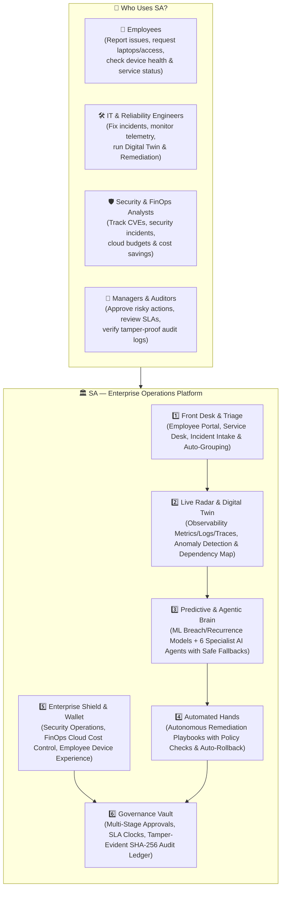

### 1.2 The Six Pillars Explained Simply

| Pillar | Real-World Analogy | What It Actually Does in SA |
|---|---|---|
| **1. Front Desk & Triage** (`Workspace` & `Service Management`) | Hospital Emergency Triage & Concierge Desk | Employees request laptops/software (`/catalog`) or report an issue (`/portal`). If 20 employees report *"Payroll is showing error 503"*, SA automatically recognises they are talking about the same problem, groups them under one master incident, raises the priority to **Critical (P1)**, assigns the right team, and starts a countdown clock (SLA). |
| **2. Live Radar & Digital Twin** (`Operations` & `Observability` / `Digital Twin`) | Air-Traffic Radar & 3D Building Blueprint | Servers send live heartbeat signals (metrics, logs, traces) to SA (`/observability`). SA's **Digital Twin** (`/digital-twin`) keeps a live map of which business service depends on which app and database. Before an engineer upgrades a database, they can run a **What-If Simulation** to see which services and how many users would be affected — without touching the real system. |
| **3. Predictive & Agentic Brain** (`Predictions`, `SA Agents`, `SA AI`) | Weather Forecaster + Team of Specialist Consultants | **Predictions** (`/predictions`) looks at past history to calculate the exact probability that an open ticket will breach its deadline or recur within 14 days. **SA Agents** (`/agents`) is a team of 6 specialist investigators (Incident, Root Cause, Change Risk, Knowledge, Infrastructure, Resolution) that read logs, check recent deployments, and propose a fix. **Crucially:** AI agents can *only read* data — they can never change anything on their own without human approval. |
| **4. Automated Hands** (`Remediation`, `Workflows`, `Runbooks`) | Autopilot with an Emergency Parachute | When a known issue happens (like a database running out of connections), **Autonomous Remediation** (`/remediation`) runs an pre-approved, step-by-step playbook. Before running, it checks 7 safety rules (e.g., *"Is there a holiday change freeze?"*, *"How many services could this affect?"*). If step 2 fails, SA **automatically rolls back** step 1 in reverse order and writes every action into a **tamper-proof cryptographic ledger**. |
| **5. Enterprise Shield & Wallet** (`Security Operations`, `FinOps`, `Employee Experience`) | Building Security, Chief Financial Officer & Employee Wellness | **Security Operations** (`/security`) ingests vulnerability scans and ranks them from `0–100` based on whether the server is exposed to the internet and whether hackers have a known exploit. **FinOps** (`/finops`) imports cloud bills, spots sudden spending spikes, tracks monthly budgets, and suggests downsizing idle servers. **Employee Experience (DEX)** (`/dex`) scores every employee laptop from `0–100` (CPU, memory, boot time, app crashes, login success) so IT can fix slow laptops before employees even complain. |
| **6. Governance Vault** (`Approvals`, `SLA Monitor`, `Audit Logs`) | Notary Public & Black-Box Flight Recorder | Risky actions (running a production playbook, accepting a security vulnerability, deploying an emergency change, applying an AI-proposed action) require sign-off in **Approvals** (`/approvals`) — and the person who requested it is never allowed to approve their own request (**Segregation of Duties**). Every action is permanently recorded in **Audit Logs** (`/audit-logs`). |

---

## 2. System Design & Engineering Principles

### 2.1 Core Design Principles (Ground Rules)

1. **Zero Fabricated Metrics**: Every KPI, trend line, SLA percentage, prediction score, FinOps dollar figure, and DEX score is computed from rows in PostgreSQL. When sample counts are too small to compute a statistically valid figure, the API returns `status: "INSUFFICIENT_DATA"` and the UI explains why rather than inventing numbers.
2. **Strict Simulation Isolation (`simulated = true`)**:
   - Synthetic telemetry, faults, vulnerability waves, cost spikes, and endpoint degradations are generated **only** when a `SYSTEM_ADMIN` enables **Simulation Mode** (`/api/simulation/*`), which is itself gated behind `SIMULATION_ALLOWED=true`.
   - Every synthetic row carries `simulated = true` in the database and a visible **SIMULATION** badge in the UI.
   - All Release 1–3 operational aggregates (Command Center KPIs, SLA compliance, MTTA/MTTR, incident trends, scheduled reports, CSV/PDF exports) exclude `simulated = true` rows by default (`WHERE NOT simulated`).
   - Turning Simulation Mode off or calling `DELETE /api/simulation/data` purges simulated records cleanly without touching real or demo (`is_demo`) records.
3. **Honest AI & Deterministic Fallback**:
   - Every AI feature (`SA AI` and `SA Agents`) works in two modes: live LLM (`AnthropicLlmProvider` wrapped in JSON-schema-validating `GuardedLlm`) and deterministic `FALLBACK`.
   - Every response and persisted step records `source: "LLM"` or `source: "FALLBACK"`, and the UI displays a prominent badge (`LLM` vs `Deterministic fallback — not AI-generated`).
   - Agent tools execute strictly **read-only** queries scoped to the requesting user's role and permissions. Any state-mutating recommendation creates a pending `Approval` (`AI_ACTION`) that must be approved by an authorised human role.
4. **Defense-in-Depth Security**:
   - Short-lived access tokens (`15 min`, held in JavaScript memory only, never `localStorage`) paired with rotating `HttpOnly` refresh cookies (`nexus_refresh`) with token-family replay detection.
   - Dual-layer authorisation: URL-level gates in `SecurityConfig.java` (so unauthenticated or unauthorised callers receive `401`/`403` *before* request body validation) plus method-level `@PreAuthorize` expressions using central role constants in `Roles.java`.
   - SSRF protection (`UrlSafety`) on all outbound webhook, Prometheus pull, and execution-system connectors, blocking loopback, link-local, RFC-1918, and cloud metadata (`169.254.169.254`) addresses in production.

### 2.2 Concurrency, Connection-Pool & Scheduler Design

A critical system design constraint in database-backed operational platforms is preventing background workers and asynchronous event listeners from exhausting the JDBC connection pool and deadlocking HTTP request threads.

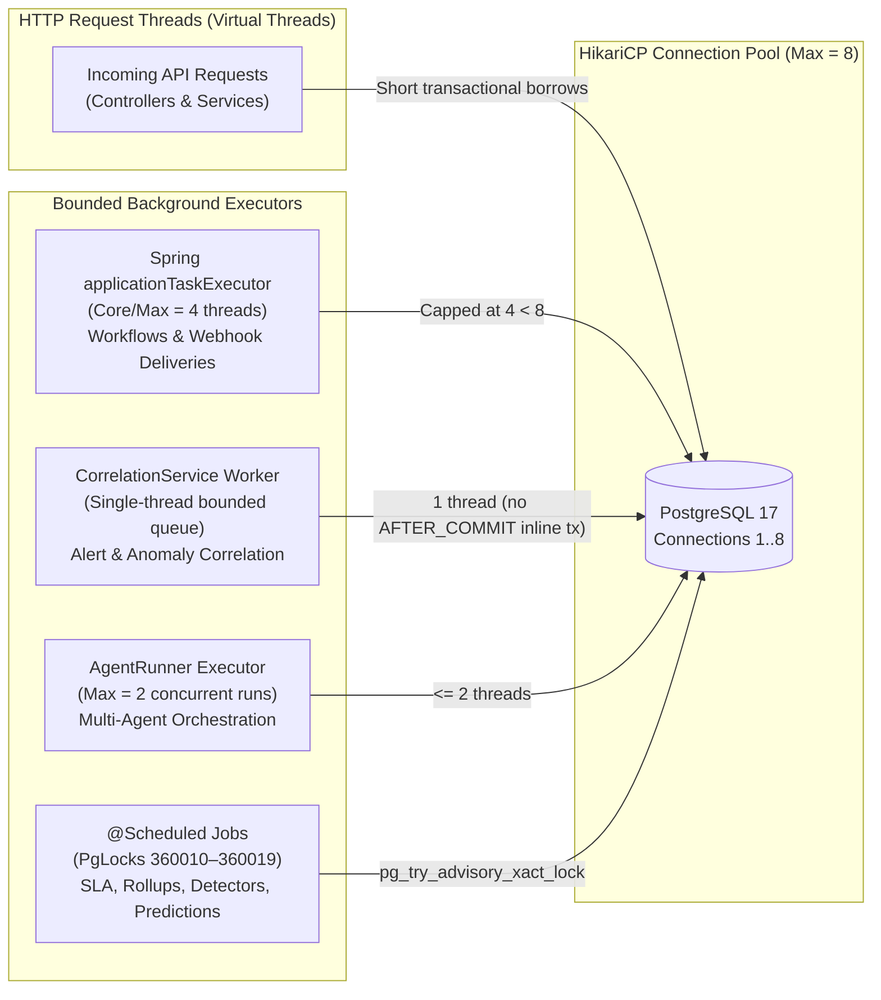

- **Connection Pool Sizing**: HikariCP `maximum-pool-size` defaults to `8` (`DB_POOL_MAX`), while Spring's `@Async` pool (`ASYNC_POOL_SIZE`) is capped at `4`, `AgentRunner` is capped at `2` concurrent runs, and `CorrelationService` runs on `1` dedicated worker thread. Background tasks can therefore never hold all 8 connections and starve HTTP requests.
- **No `REQUIRES_NEW` Inside `AFTER_COMMIT` on Request Threads**: Event listeners triggered after transaction commit hand work off to bounded background queues rather than opening a second database connection on the caller's thread.
- **Cluster-Safe Scheduled Jobs via PostgreSQL Advisory Locks**: Every periodic background job acquires a non-blocking transaction-level advisory lock (`SELECT pg_try_advisory_xact_lock(key)`) so multiple API replicas never duplicate work:

| Lock ID | Job / Engine | Interval | Purpose |
|---|---|---|---|
| `360010` | `SlaEscalationJob` | 60 s | Evaluates business-hours SLA clocks, marks breaches, triggers escalations |
| `360011` | `WorkflowScheduleJob` | 60 s | Triggers cron/interval scheduled workflows |
| `360012` | `EmailOutboxJob` | 30 s | Delivers queued transactional emails via SMTP (or marks `SKIPPED`) |
| `360013` | `ReportScheduleJob` | 60 s | Generates scheduled PDF/CSV analytics reports |
| `360014` | `ObservabilityJobs` (Rollup/Retention/Pull) | 60 s / 1 h | Computes 5m/1h metric rollups, enforces retention, pulls Prometheus targets |
| `360015` | `AnomalyEvaluationJob` | 60 s | Evaluates enabled EWMA / Median-MAD anomaly detectors |
| `360016` | `SimulationJobs` | 15 s | Advances active synthetic simulation scenarios when Simulation Mode is ON |
| `360017` | `PredictionJobs` (Retrain) | Daily | Retrains predictive models on new historical outcomes |
| `360018` | `PredictionJobs` (Refresh) | 5 m | Refreshes active SLA breach, recurrence, and capacity predictions |
| `360019` | `PredictionJobs` (Outcomes) | 15 m | Reconciles served predictions against actual incident/SLA outcomes |

### 2.3 Cryptographic Audit Integrity (`remediation_audit`)

Autonomous remediation actions carry high operational sensitivity. In addition to the general append-only `audit_logs` table, `remediation_audit` implements a **tamper-evident SHA-256 hash chain**:

$$\text{hash}_n = \text{SHA-256}\left(\text{prev\_hash}_{n-1} \;\|\; \text{event\_type}_n \;\|\; \text{run\_id}_n \;\|\; \text{playbook\_id}_n \;\|\; \text{actor\_id}_n \;\|\; \text{canonical\_json(payload)}_n \;\|\; \text{created\_at\_micros}_n\right)$$

- The first record links to `prev_hash = "GENESIS"`.
- A PostgreSQL `BEFORE UPDATE OR DELETE` trigger (`trg_remediation_audit_immutable`) raises an exception at the database layer if any query attempts to modify or delete a row.
- `GET /api/remediation/audit/verify` recomputes every hash from `GENESIS` in id order and reports `{ valid: true, totalRecords, firstBrokenId: null }`.

---

## 3. Technical System Architecture

### 3.1 High-Level Container Architecture

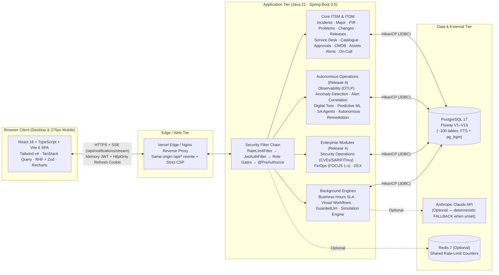

### 3.2 Backend Domain Package Architecture (`com.nexus360.*`)

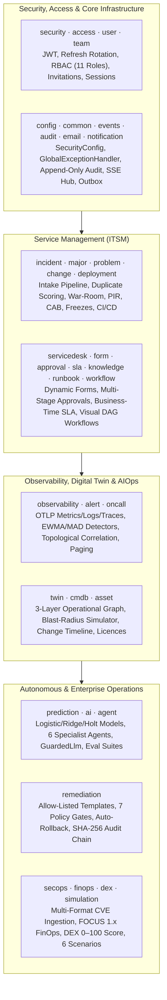

---

## 4. End-to-End Workflows

### 4.1 Workflow 1: Intelligent Incident Intake → Duplicate Grouping → SLA → Major Incident → Post-Incident Review

When multiple employees report the same outage in their own words, SA automatically classifies, prioritises, groups duplicates under a parent incident, starts the business-hours SLA clock, recommends knowledge articles, and drives major-incident command through to a signed-off Post-Incident Review (PIR).

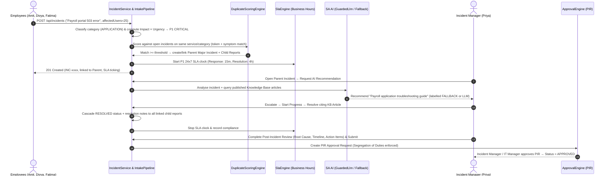

### 4.2 Workflow 2: Full-Stack Observability → Anomaly Detection → Alert Correlation → Incident

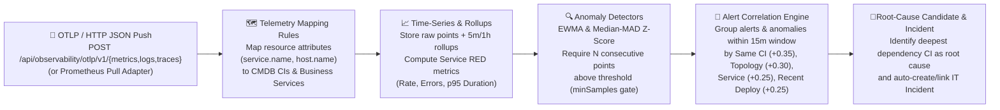

### 4.3 Workflow 3: Digital Twin Blast-Radius & Change Impact Simulation

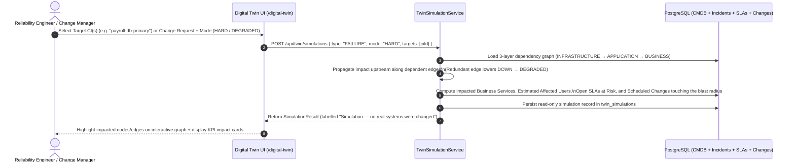

### 4.4 Workflow 4: Multi-Agent AI Investigation (`SA Agents`) → Approval-Gated Action

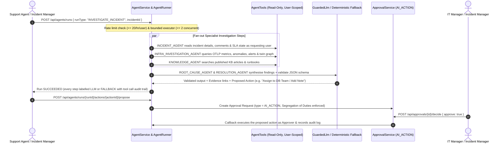

### 4.5 Workflow 5: Autonomous Remediation Playbook → 7 Policy Gates → Auto-Rollback & Hash-Chain Verification

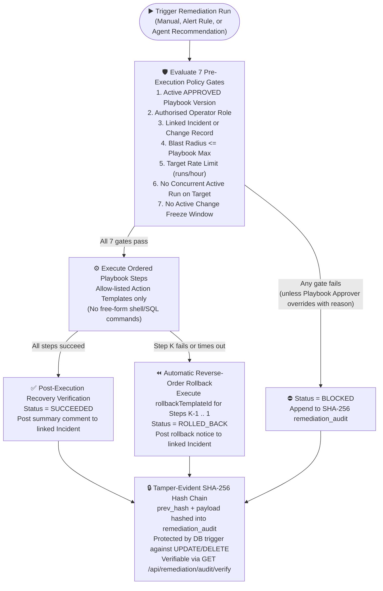

### 4.6 Workflow 6: Security Operations — Multi-Format Vulnerability Ingestion → Risk Scoring → Acceptance Workflow

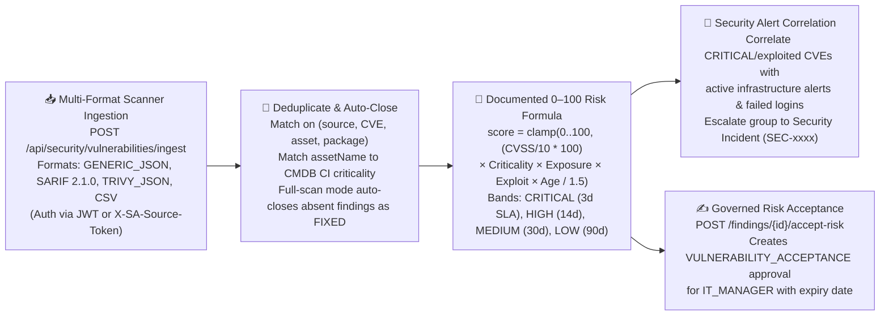

### 4.7 Workflow 7: FinOps — FOCUS 1.x CSV Dry-Run → Allocation → Budgets → Savings Change Request

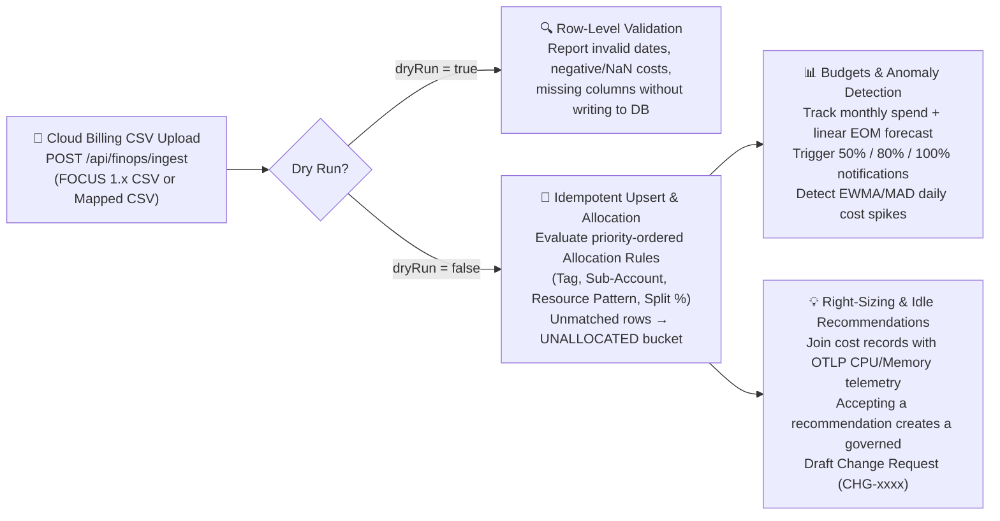

### 4.8 Workflow 8: Digital Employee Experience (DEX) — Telemetry → Composite Score → Proactive Incident

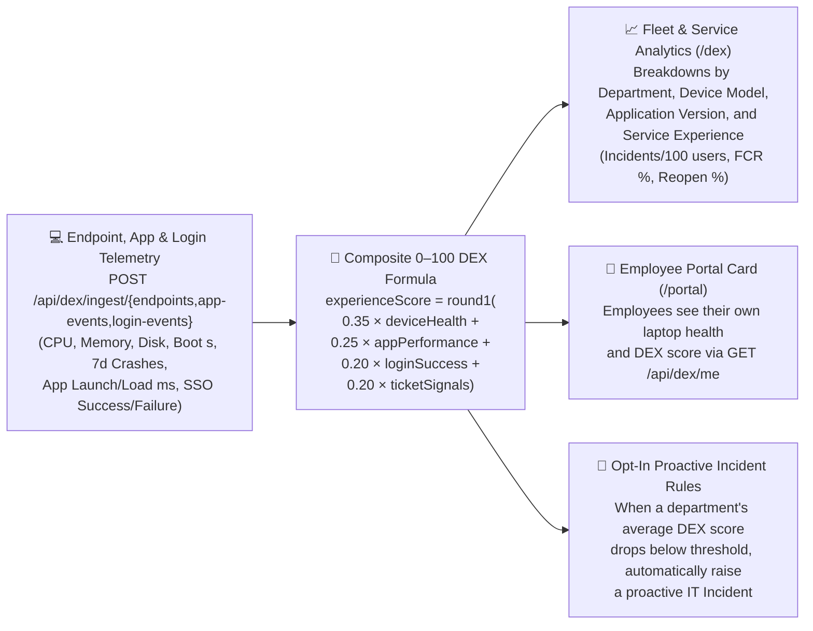
